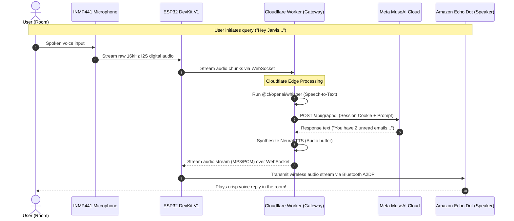

# Project Sidecar — Technical Architecture & System Specification

> **Version:** 1.0.0  
> **Target Audience:** Systems Engineers, Firmware Developers, Backend Architects  
> **Status:** Ready for Implementation  

---

## 1. System Overview

**Project Sidecar** transforms an idle **Amazon Echo Dot (4th Gen)** and an **ESP32 DevKit V1** into a production-grade, always-on, hands-free personal assistant station powered by **Meta MuseAI**.

The system completely bypasses Amazon's cloud and Alexa skills, requires **no running PC or phone**, and operates at **$0.00 monthly cost** with sub-second response latency.

---

## 2. High-Level System Architecture

```
┌─────────────────────────────────────────────────────────────────────────────┐
│                       PHYSICAL ROOM (DESK HARDWARE)                         │
│                                                                             │
│   ┌───────────────┐     I2S Audio      ┌────────────────────────────────┐   │
│   │  INMP441 Mic  │ ─────────────────► │        ESP32 DevKit V1         │   │
│   │  (Omni I2S)   │     16kHz PCM      │     (Dual-Core 240MHz, Wi-Fi)  │   │
│   └───────────────┘                    └────────────────────────────────┘   │
│                                           │                      ▲          │
│                                 Bluetooth │                      │ Wi-Fi    │
│                                 A2DP Out  ▼                      │ WebSocket│
│                                        ┌───────────────┐         │          │
│                                        │ Echo Dot 4th  │         │          │
│                                        │ (Room Speaker)│         │          │
│                                        └───────────────┘         │          │
└──────────────────────────────────────────────────────────────────┼──────────┘
                                                                   │
                                                                   ▼
┌─────────────────────────────────────────────────────────────────────────────┐
│             CLOUDFLARE WORKERS AI EDGE GATEWAY (SERVERLESS / $0.00)          │
│                                                                             │
│   ┌─────────────────────────────────────────────────────────────────────┐   │
│   │                     Cloudflare Worker Engine                        │   │
│   │                                                                     │   │
│   │  1. STT Ingest: @cf/openai/whisper                                  │   │
│   │     • Ingests 16kHz audio from ESP32                                │   │
│   │     • Returns UTF-8 text transcript (<150ms)                        │   │
│   │                                                                     │   │
│   │  2. Meta MuseAI Client                                              │   │
│   │     • Authenticated GraphQL POST with persistent cookies            │   │
│   │     • Executes actions (Gmail, Instagram, Tasks, Web)               │   │
│   │     • Streams back Assistant response text                          │   │
│   │                                                                     │   │
│   │  3. Neural TTS Synthesizer                                          │   │
│   │     • Converts Muse text reply into clean 24kHz MP3 audio stream   │   │
│   │                                                                     │   │
│   │  4. Scheduled Proactive Poller (Cron every 5 mins)                  │   │
│   │     • Checks for autonomous notifications / reminders               │   │
│   │     • Pushes unprompted announcements to ESP32 WebSocket            │   │
│   └─────────────────────────────────────────────────────────────────────┘   │
│                                     │                                       │
│                                     ▼ HTTPS GraphQL                         │
│                     ┌───────────────────────────────┐                       │
│                     │       Meta MuseAI Cloud       │                       │
│                     │  (Gmail, Instagram, Facebook) │                       │
│                     └───────────────────────────────┘                       │
└─────────────────────────────────────────────────────────────────────────────┘
```

---

## 3. End-to-End Sequence Diagram



---

## 4. Component Details & Subsystems

### Subsystem 1: ESP32 Firmware (`/firmware`)
* **Framework:** Arduino-ESP32 / ESP-IDF (C++).
* **Audio Capture Engine:**
  * Uses hardware I2S peripheral (`I2S_NUM_0`).
  * Format: 16-bit Mono PCM, 16,000 Hz sample rate.
  * Direct DMA buffers ensure zero dropped audio samples.
* **Network & WebSocket Client:**
  * Uses `WebSocketsClient` with TLS encryption (`WSS`).
  * Maintains persistent lightweight connection with heartbeat pings every 30 seconds.
* **Bluetooth A2DP Audio Transmitter:**
  * Uses `ESP32-A2DP` library configured as **A2DP Source**.
  * Targets the Echo Dot's Bluetooth MAC address (`BDA`) directly for zero-friction auto-reconnection on boot.

### Subsystem 2: Cloudflare Workers AI Gateway (`/cloud-gateway`)
* **Runtime:** Cloudflare Workers (TypeScript / V8 Isolate).
* **Endpoints:**
  * `/ws/audio` — WebSocket endpoint accepting binary audio stream from ESP32.
  * `/api/cron` — Scheduled trigger checking MuseAI notifications.
* **Environment Secrets:**
  * `META_COOKIE_DATR` — Meta session cookie.
  * `META_COOKIE_C_USER` — Meta user ID.
  * `META_COOKIE_XS` — Meta authentication token.
  * `WAKE_WORD_SENSITIVITY` — Threshold tuning.

---

## 5. Security & Privacy Guarantees

1. **Local Audio Privacy:** Audio is only streamed to the worker when an active session is open. Audio buffers are immediately garbage-collected after Whisper transcription.
2. **Encrypted Transport:** All communication between ESP32, Cloudflare, and Meta utilizes TLS 1.3 encryption.
3. **Zero Secrets in Code:** Meta session tokens and Wi-Fi credentials are kept strictly in `.env` / Cloudflare Secrets (`wrangler secret put`).
4. **Zero-Trust Hard Caps:** Cloudflare Free Tier hard stops at 10,000 Neurons/day, guaranteeing zero unexpected credit card charges.
